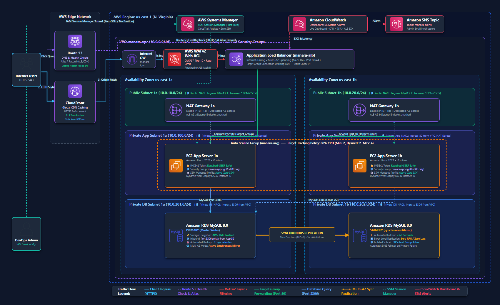
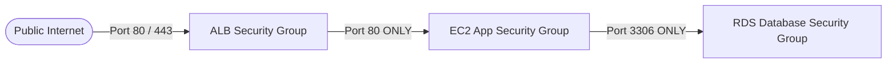

# 🚀 Highly Available & Scalable Web Application on AWS


**Author:** Mohamed Adel Zaki Alksas  
**Program:** AWS Solutions Architect – Associate (SAA-C03) Graduation Project  
**Organization:** [Manara.tech](https://manara.tech/)  
**Supervisor / Author:** Ayman Aly Mahmoud  

---

## 📌 Executive Summary

This repository contains the complete, production-grade Infrastructure as Code (IaC) written in **Terraform** to deploy a resilient, fault-tolerant, and secure **Multi-Tier Web Application Architecture** on Amazon Web Services (AWS). 

Designed in strict accordance with the **AWS Well-Architected Framework**, this project solves single-point-of-failure risks by spanning across multiple Availability Zones (`us-east-1a` and `us-east-1b`), isolating compute workloads in private subnets, auto-scaling compute capacity based on live demand, and protecting application boundaries using AWS WAF and CloudFront edge caching.

---

## 🏛️ Solution Architecture Diagram



### End-to-End Traffic & Data Flow
1. **Edge & DNS:** Users query **Amazon Route 53**, which resolves the domain via an **Alias A Record** pointing to **Amazon CloudFront**.
2. **Security Edge:** Inbound traffic passes through **AWS WAF (Web Application Firewall)**, inspecting requests against the **OWASP Top 10** managed rule set and rate-limiting potential DDoS attacks.
3. **Public Ingress:** Legitimate traffic enters the **VPC (10.0.0.0/16)** through an **Internet Gateway (IGW)** to the internet-facing **Application Load Balancer (ALB)** distributed across two public subnets.
4. **Private Compute:** The ALB forwards HTTP requests across an **Auto Scaling Group (ASG)** of EC2 instances running inside **Private Application Subnets**. Instances are inaccessible from the public internet.
5. **Private Data Tier:** App servers communicate with an **Amazon RDS MySQL Multi-AZ** database cluster. The primary database writes synchronously to a standby replica in the second Availability Zone.
6. **Outbound Internet:** Private EC2 instances access external security patches and OS updates via dedicated **NAT Gateways** deployed in each public subnet.
7. **Bastion-Free Management:** Engineers securely administer EC2 instances using **AWS Systems Manager (SSM) Session Manager**, completely eliminating the need for exposed SSH ports or Bastion Jump Hosts.
8. **Observability:** **Amazon CloudWatch** monitors CPU utilization and ALB target error rates, triggering automated **Amazon SNS** email alerts upon threshold breaches.

---

## ⚙️ Key AWS Services & Architectural Decisions

| Service | Architectural Role & Implementation Details |
| :--- | :--- |
| **Amazon VPC** | Custom `10.0.0.0/16` network divided into **6 subnets across 2 AZs** (2 Public, 2 Private App, 2 Private DB) for network segmentation. |
| **NAT Gateways** | **Dual NAT Gateways** deployed across both AZs (`us-east-1a` and `us-east-1b`) ensuring outbound high availability even if an AZ suffers a blackout. |
| **Application Load Balancer** | Layer 7 routing with active HTTP health checks (`/`), path routing, and target group **deregistration delay (connection draining)** set to 30s. |
| **Auto Scaling Group (ASG)** | Spans both private subnets with a Launch Template. Uses a **Target Tracking Policy maintaining 60% average CPU utilization** (Min: 2, Desired: 2, Max: 4). |
| **Amazon RDS (Multi-AZ)** | Managed MySQL 8.0 with **Synchronous Multi-AZ Replication** providing sub-60s automated failover with zero data loss. Storage encrypted with AWS KMS. |
| **Amazon CloudFront** | Global Content Delivery Network (CDN) caching static assets, offloading dynamic hits from the ALB, and enforcing HTTPS. |
| **AWS WAFv2** | Web ACL attached to ALB/CloudFront blocking SQL injection (SQLi), Cross-Site Scripting (XSS), and limiting aggressive bots. |
| **AWS Systems Manager** | Replaces risky SSH keys with IAM-authenticated **Session Manager**, logging all administrative sessions to AWS CloudTrail. |
| **CloudWatch + SNS** | Real-time metric alarms for high CPU (>75%) and ALB 5XX errors triggering automated email notifications. |

---

## 🔒 Layered Security & Defense-in-Depth

All network traffic adheres to the **Principle of Least Privilege** using chained Security Groups:



### Security Group Ingress / Egress Matrix

| Security Group | Inbound Rules | Outbound Rules | Purpose |
| :--- | :--- | :--- | :--- |
| **`manara-alb-sg`** | `TCP 80, 443` from `0.0.0.0/0` | `TCP 80` to `manara-app-sg` | Public entry point for HTTP/HTTPS web traffic. |
| **`manara-app-sg`** | `TCP 80` **strictly from** `manara-alb-sg` | `All Traffic` to `0.0.0.0/0` (via NAT) | Web tier instances; direct internet access is blocked. |
| **`manara-db-sg`** | `TCP 3306` **strictly from** `manara-app-sg` | `None` | Database tier; completely isolated from the web. |

---

## 📂 Repository File Structure

```text
.
├── architecture_diagram.png          # High-resolution Solution Architecture Diagram
├── README.md                          # Comprehensive project documentation
└── terraform/
    ├── provider.tf                    # AWS provider definition and default tags
    ├── variables.tf                   # Input variables, CIDRs, and instance sizes
    ├── terraform.tfvars.example       # Sample environment configuration values
    ├── vpc.tf                         # VPC, Internet Gateway, Elastic IPs, and Route Tables
    ├── subnets.tf                     # 6 Subnets across 2 AZs and Route Table Associations
    ├── security_groups.tf             # Chained security groups enforcing least-privilege
    ├── alb.tf                         # Application Load Balancer, Target Group, and Listeners
    ├── asg.tf                         # Launch Template (Amazon Linux 2023) and Auto Scaling
    ├── rds.tf                         # Multi-AZ RDS MySQL database and DB Subnet Group
    ├── ssm.tf                         # IAM Roles and instance profile for Session Manager
    ├── cloudfront.tf                  # CloudFront CDN distribution and caching behaviors
    ├── route53.tf                     # Route 53 Hosted Zone, Alias A record, and Health Check
    ├── waf.tf                         # AWS WAFv2 Web ACL with OWASP Top 10 rules
    ├── cloudwatch.tf                  # Metric alarms (CPU / 5XX) and SNS notification topic
    └── outputs.tf                     # Exported endpoints, DNS names, and ARNs
```

---

## 🚀 Step-by-Step Deployment Guide

### Prerequisites
* [Terraform](https://www.terraform.io/downloads.html) `>= 1.5.0` installed.
* [AWS CLI](https://aws.amazon.com/cli/) configured with administrative privileges (`aws configure`).

### 1. Clone the Repository
```bash
git clone https://github.com/MohamedAlksas/Manara-SAA-Project1-Scalable-Web-App.git
cd Manara-SAA-Project1-Scalable-Web-App/terraform
```

### 2. Configure Environment Variables
Copy the example variables file and adjust parameters as needed:
```bash
cp terraform.tfvars.example terraform.tfvars
```

### 3. Initialize & Review Plan
```bash
# Initialize Terraform provider plugins and backend
terraform init

# Validate syntax and formatting
terraform validate

# Review the execution plan
terraform plan
```

### 4. Deploy Infrastructure
```bash
terraform apply -auto-approve
```
*Deployment takes approximately 5 to 7 minutes (primarily for the Multi-AZ RDS cluster).*

### 5. Access the Application
Once deployed, retrieve the outputs:
```bash
terraform output alb_dns_name
terraform output cloudfront_domain_name
```
Paste the `alb_dns_name` or `cloudfront_domain_name` into your web browser to view the application live!

---

## 🧪 Verification & High Availability Testing

### Test 1: Load Balancing & High Availability
1. Refresh the web page multiple times in your browser.
2. Observe that the **Availability Zone** and **Instance ID** automatically alternate between `us-east-1a` and `us-east-1b`, proving active Layer 7 traffic distribution.

### Test 2: Auto Scaling Self-Healing
1. Navigate to the EC2 Console and manually terminate one of the web instances.
2. Within 60 seconds, the ALB health check marks the terminated instance as unhealthy, and the **Auto Scaling Group automatically provisions a brand-new instance** to maintain the desired capacity of 2.

### Test 3: RDS Multi-AZ Automated Failover
1. In the RDS Console, select `manara-mysql-database` $\rightarrow$ **Actions** $\rightarrow$ **Reboot**.
2. Select **"Reboot with failover"**.
3. Observe that the database seamlessly promotes the standby replica in the secondary AZ to primary with zero downtime for the application tier.

---

## 🧹 Teardown & Resource Cleanup

To avoid incurring ongoing AWS charges after evaluation:
```bash
terraform destroy -auto-approve
```

---

## 🎓 Deliverables Compliance Checklist (Manara SAA-C03)

- [x] **Solution Architecture Diagram:** Provided in visual PNG format created with Diagrams as Code (`architecture_diagram.png`).
- [x] **Public GitHub Repository:** Fully documented code repository with modular Terraform configuration.
- [x] **VPC Architecture:** Multi-AZ public and private subnets with Dual NAT Gateways.
- [x] **High Availability Compute:** ALB + EC2 Auto Scaling Group with Target Tracking policy.
- [x] **Multi-AZ Database:** Fully managed Amazon RDS MySQL with automated failover.
- [x] **Edge Delivery & Security:** CloudFront CDN caching, Route 53 Alias record, and AWS WAF OWASP rules.
- [x] **Bastion-Free Access:** AWS Systems Manager Session Manager IAM integration.
- [x] **Observability:** CloudWatch Alarms integrated with Amazon SNS alerts.
